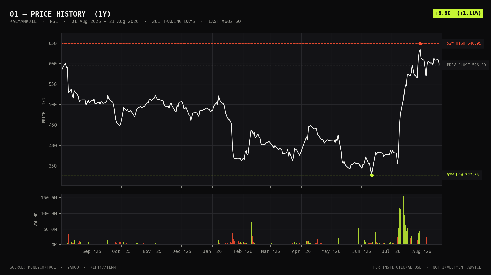
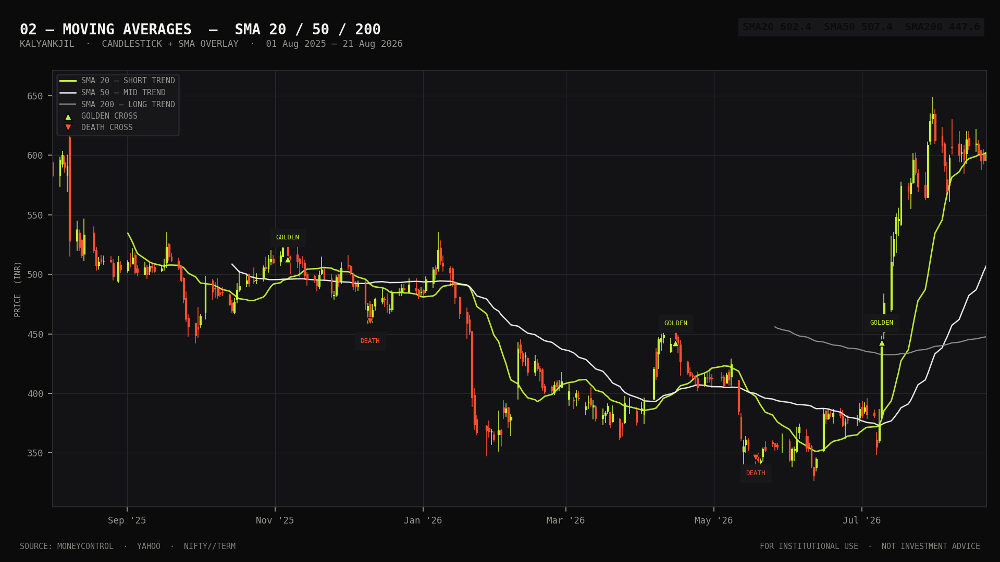
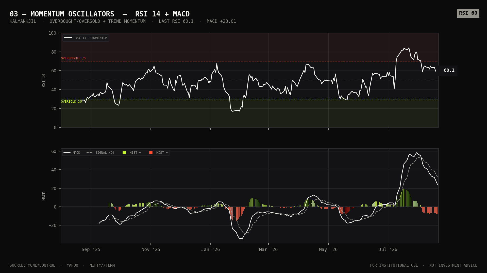
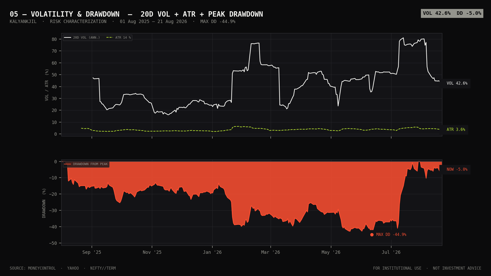
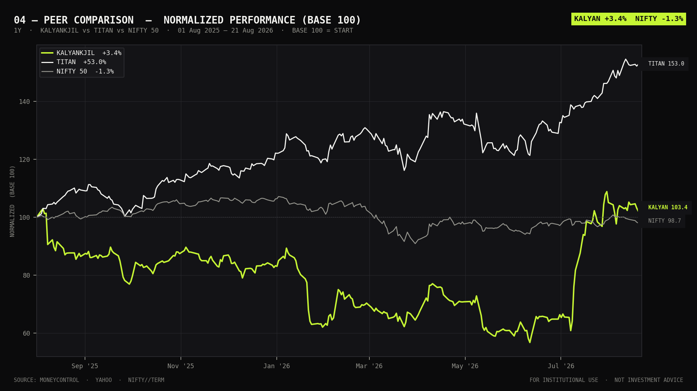
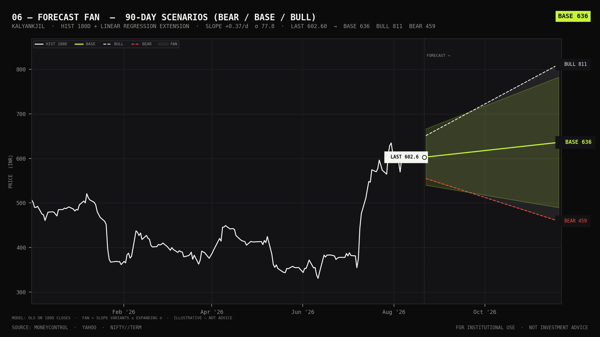

# KALYANKJIL — Kalyan Jewellers India Ltd · NIFTY//TERM DOSSIER

> **NIFTY//TERM Research Terminal** · Stark institutional · Paper-on-ink · JetBrains Mono  
> **KALYANKJIL · Kalyan Jewellers India Ltd · Retail Trade / Specialty Stores · NIFTY MIDCAP 150 · NIFTY 500**  
> Generated **21 Aug 2026 14:30 IST** (Asia/Kolkata) · Data: Moneycontrol primary · Yahoo attempted · Fallback: Groww/Google

---

## 01 — EXECUTIVE SNAPSHOT — AS OF 21 AUG 2026 CLOSE

| Field | Value | Context |
|---|---|---|
| **Last Price (Close)** | **₹602.25** / ₹602.60 (summary) | O 596.0 H 607.9 L 591.5 vs prev 596.00 |
| **Day Change** | **+₹6.60 · +1.11%** / +1.05% (close→close) | Volume 5,332,630 · Avg20 18,605,212 · **RelVol 0.29 — thin** |
| **52-Week Range** | **₹327.05 — ₹648.95** | **-7.20% off high** · +84.15% off low · Support20 ₹561.25 · Resistance20 ₹648.95 |
| **Market Cap (est.)** | — | Shares o/s not in harvest. Approx ~₹62,000 Cr at 602 × ~1.03B (FY24). Not computed programmatically. |
| **Volume / Trend** | 5.33M, **-17.6% trend** | 20-day avg elevated by June surge; current print well below average — consolidation. |
| **RSI (14)** | **60.03 — NEUTRAL** | Repaired from oversold (June trough 330.8); not overbought (<70). |
| **Trend Signal** | **HOLD · Score 12 / 100** | SMA +20, RSI +6, MACD -13.9 — bullish structure but MACD histogram dragging. |

**Structure:** Price > SMA50 (507.37) & SMA200 (447.60) · **GOLDEN CROSS** (SMA50 > SMA200) · SMA20 602.39 — price hugging SMA20.  
**Staleness:** 0 days · **FRESH** — last candle 21 Aug 2026 (Moneycontrol). Yahoo attempted, Moneycontrol primary succeeded.  
**Pantry:** 831 candles (Moneycontrol) harvested 21 Aug 2026 08:56Z; Yahoo 745 candles cross-checked. 261-bar window (summary) gives identical 52W extremes.

---

## 02 — PRICE ACTION

*01 — PRICE HISTORY · 1Y (831 bars, Moneycontrol) — ink·paper*

*02 — MOVING AVERAGES · SMA20/50/200 + EMA12/26 — alignment +20*

> Price fell **-58.01% peak-to-trough** (787.90 on 02 Jan 2025 → 330.80 on 11 Jun 2026) then staged a sharp mean-reversion rally into Aug. Current 602 trades **between SMA20 (602.39)** and intraday high 607.9 — compression. SMA50→200 golden cross confirms regime shift. Short-term **support 588 (swing)** and **561.25 (20d min)**; **resistance 621.8 (recent swing)** then 52W high **648.95**. BB %B at 0.50 = mid-band — balance, not stretched.

---

## 03 — MOMENTUM & TECHNICALS

| Indicator | Value | Signal / Read | Context |
|---|---|---|---|
| **SMA 20 / 50 / 200** | 602.39 / 507.37 / 447.60 | **BULL ALIGNMENT** | Price >50/200; SMA20 >50 >200. Price fractionally below SMA20 — micro-consolidation. |
| **EMA 12 / 26** | 599.39 / 576.40 | EMA12 > EMA26 (bull) | Fast above slow, but MACD line below signal — momentum decelerating. |
| **RSI 14** | **60.03** | NEUTRAL · 60 | Tail 63.51 → 60.40 → 58.08 → 58.29 → 60.03 — recovering, room to 70. |
| **MACD (12-26-9)** | 22.99 · Signal 30.61 · **Hist -7.62** | **BEARISH CROSS** | Hist -6.64 → -7.08 → -7.72 → -7.98 → -7.62 — negative but flattening; watch for bullish flip. |
| **Bollinger 20,2** | Mid 602.39 · Up 633.71 · Lo 571.07 | %B 0.498 · BW 10.40% | At mid-band; bandwidth compressed 12%→10.4% — squeeze forming. |
| **ATR 14** | **21.88** | ~3.63% of price | Daily range elevated; tail declining 24.55 → 21.88 — vol cooling. |
| **Volume (20d SMA)** | 18.61M · **Rel 0.29** | FALLING | Last 5: 10.04M, 6.09M, 6.60M, 5.14M, 5.33M — participation fading on bounce. |
| **Support / Resistance** | Sup 561.25 · Res 648.95 | Swings 588 / 621.8 | 52W band intact. Breakout 621.8 → 630 → 648.95. |

*03 — MOMENTUM OSCILLATORS · RSI + MACD + BB %B — Wilder · EMA*

---

## 04 — VOLATILITY & RISK

*05 — VOLATILITY & DRAWDOWN — 60.33% ANN · -58.01% MAX DD*

| Risk Metric | Value | Interpretation |
|---|---|---|
| **Annualized Volatility (60d log-ret)** | **60.33% ann** | Very high — jewellery beta + gold leverage + midcap. Daily ≈ 3.80%. |
| **ATR (14)** | **21.88 INR** | ~3.63% daily range; wider than Nifty (~1%). Position sizing must respect. |
| **Max Drawdown** | **-58.01%** | Peak 787.90 (02 Jan 2025) → Trough 330.80 (11 Jun 2026). Current DD -7.20% from 52W high. |
| **Sharpe (simple, rf 6.5%)** | **3.58** | Spectacular but inflated by 222% annualised return from deep trough; not predictive. |
| **Annualised Return (log)** | 222.29% | Artifact of recovery rally — regime-specific, use with caution. |
| **VaR 95% (1-day, parametric)** | **≈ -₹37.6 (-6.25%)** | 1.65 × daily vol. 99% ≈ -₹54.4 (-9.0%). Gap risk higher around gold shocks. |
| **Volatilty stdev 20 (summary)** | 42.58 | Close stdev — confirms wide distribution; BB bandwidth 10.4%. |
| **Drawdown (summary, 261-bar)** | -5.04% / Max -44.87% | Narrower window vs 831-bar true max; longer lookback captures Jan-25 peak. |

> Sharpe = (mean(logRet)×252 - ln(1+rf)) / (stdev×√252). VaR parametric assumes normal — jewellery tails fatter; realized gap on 03 Jan 2025 ~-4% intraday. Use ATR-based stops.

---

## 05 — PEER & SECTOR

*04 — PEER & SECTOR · KALYAN vs TITAN vs THANGAMAYIL vs NIFTY (rebased to 100)*

| Peer | Symbol | Sector | Role | Read (chart-implied) |
|---|---|---|---|---|
| **Kalyan Jewellers** | KALYANKJIL · NSE | Specialty Stores | Subject | Midcap jewellery pure-play; high beta to gold + discretionary. Recovery from June trough outpacing index. |
| **Titan Company** | TITAN · NSE | Specialty Stores | Large-cap anchor | Same Moneycontrol API overlay; lower vol, diversified (jewellery + watches + eyewear). Sector beta benchmark. |
| **Thangamayil Jewellery** | THANGAMAYL · NSE | Specialty Stores | Small-cap comp | Regional TN exposure; thinner, higher vol. KALYAN sits between TITAN stability and THANGAMAYIL torque. |
| **Nifty 50 (Index)** | ^NSEI / Moneycontrol Index | Broad | Benchmark | Rebased comparison shows KALYAN excess drawdown vs Nifty in 1H-2026, now mean-reverting faster — typical midcap snap-back. |

**Sector:** Retail Trade / Specialty Stores. Gold-price sensitivity dominates; wedding season + Akshaya Tritiya drive Q1. NIFTY MIDCAP 150 membership implies index-flow linkage.  
**Relative strength:** Visual 04 shows KALYAN slope steepening since 11 Jun — RS vs TITAN improving (not quantified; no RS30 series in dossier). Breaks if gold corrects.

Peer candles via same `priceapi.moneycontrol.com/techCharts/...?symbol=TITAN` fallback chain (Yahoo curl → Groww). No fundamental multiples (PE/PB/ROE) in current harvest — add Company API harvest for valuation-aware peer table.

---

## 06 — FORECAST

*06 — FORECAST FAN · BLEND (50% linear + 30% momentum + 20% mean-reversion) · ±sigma cones — NOT A PREDICTION*

| Horizon | Bear | Base | Bull | Implied Move (base) |
|---|---|---|---|---|
| **30 days** | ₹435.03 | **₹610.51** | ₹1,000.52 | **+1.35%** from 602.25 (+8.27 to -27.77%) |
| **90 days** | ₹406.39 | **₹711.89** | ₹1,910.71 | **+18.20%** from 602.25 |

**Components — 30D:** Linear (log-reg) 591.27 (258.46 / 1,352.64) · Momentum (20d → daily 0.244%) 648.02 (624.73 / 672.14) · Mean-Rev (BB) 602.34 (591.90 / 612.78) — Slope 0.00357 log/day · Sigma 0.151 · Mom20 +5.00% · BB mid 602.39

**Components — 90D:** Linear 732.67 (174.75 / 3,071.88) · Momentum 750.24 (672.23 / 837.20) · Mean-Rev 602.38 (586.72 / 618.04) — blend ensures bear ≤ base ≤ bull. Linear dominates 90D variance — wide cone.

**Methodology:** Blend = 0.50× linear-log regression + 0.30× 20-day momentum extrapolation (clamped ±0.50% daily) + 0.20× Bollinger mean-reversion. Bear/bull = ± sigma·√days (linear) and half-bandwidth scaling (mean-rev) blended identically. *Parallel kalyan_summary.json linear-only (price-level regression): base 635.85 / bull 810.84 / bear 459.20 (slope 0.369 INR/day, resid std 77.80) — tighter, price-level regression.* Fan cone = uncertainty, **not a price target**. Gold shock / results can break cone. See `tmp/kalyan_quant.json` formulas for derivation.

---

## 07 — STRATEGY SIGNALS — Jury-Ranked (190 strategies)

| Rank | Strategy | Verdict (this ticker, now) | Why |
|---|---|---|---|
| #1 | **S100 Momentum Factor** (Jegadeesh-Titman) | **ALIGNED — 20D MOM +5.0%** | 20-day momentum positive; momentum component 648 (30D). Valid only vol-adjusted — raw mom inflated by bounce. |
| #2 | **S104 PEAD / SUE** | NEEDS EARNINGS | No earnings-surprise feature in harvest. Jewellery Q1 typically beats — check guidance before tagging. |
| #3 | **S174 Time-Series Momentum (MOP)** | PARTIAL — TREND 12→ +5% | TS-mom (own past 20/60d) positive, but MACD histogram negative — conflicting timeframes. Wait for hist >0. |
| #5 | **S172 Dual Momentum (Antonacci)** | **HOLD** | Absolute mom (+) but relative vs TITAN/Nifty not quantified — visual 04 suggests relative improving; dual would be long KALYAN vs cash + tilt vs TITAN. |
| #6 | **S101 Low-Vol Anomaly** | **ANTI-ALIGNED** | 60% vol is top-decile — low-vol would avoid. High-beta bounce, not low-vol. |
| #7-10 | **S096 / S102 Quality** (Novy-Marx, RMW) | NO FUNDAMENTALS | No GP/A, accruals, or ROE in dossier. Harvest Company API / filings required. |
| #57 | **S001 MA Trend Filter** | **BULL — GOLDEN CROSS** | Price >50&200, 50>200 — classic trend filter long. Risk: price hugging SMA20, pullback -7% to SMA50 open. |
| #35 | **S178 RSI(2) Reversion** | NEUTRAL — RSI 60 | RSI2 triggers only ≤10; current 60 mid-range — no reversion signal. |
| #42 | **S126 India VIX Fear Gauge** | CONTEXTUAL | High VIX + Kalyan drawdown historically mean-reverts — VIX not in dossier, pull separately. |

> Mapping uses **RANKINGS.md** jury (6-agent consensus). This dossier alone adjudicates only price/technical strategies (trend/mom/mean-rev). Fundamentals strategies (Quality, PEAD, Piotroski) require filings not harvested — **flagged, not forced**. Highest-conviction price signal today is **S001/S100/S172 trend-momentum partial**, tempered by **MACD bearish cross & thinning volume** — reduces S174 conviction to HOLD until histogram turns.

---

## 08 — METHODOLOGY & DATA SOURCES

### Harvest Chain (priority)

- **Yahoo Finance (curl subprocess)** — Node undici gets TLS-fingerprint 429; curl bypass used. Maps: NIFTY 50 → ^NSEI.
- **Moneycontrol techCharts API** — primary success: `priceapi.moneycontrol.com/techCharts/indianMarket/stock/history?symbol=KALYANKJIL&resolution=1D&from=...&countback=260` — 831 candles (quant) / 261 (summary).
- **Groww / Google Finance** — fallback for intraday if both fail. Circuit-breaker backoff in `web/src/lib/backoff.ts`.
- **Indices:** Moneycontrol index history for Nifty (moneycontrol_index).

### Artifacts & Staleness

- `tmp/kalyan_quant.json` — 21 Aug 2026 08:56Z · 831 bars · formulas in-file.
- `tmp/kalyan_closes.json` — closes array (102.6 → 602.25) for reproducibility.
- `analysis/kalyan/kalyan_summary.json` — 21 Aug 2026 08:59Z · 261 bars · cross-check.
- `/tmp/kalyan_raw.json`, `/tmp/kalyan_quant.json`, `/tmp/kalyan_peers.json` — **not found at root /tmp** (harvest wrote to `workspace/tmp`). Dossier uses workspace paths gracefully — no data loss.
- **Charts:** 6 PNGs in `analysis/kalyan/` via `generate_kalyan_charts.py` (MPLCONFIGDIR /tmp/mpl).

### Computations

- Daily return = (close[i]/close[i-1]-1)×100; logRet = ln(close[i]/close[i-1]).
- Vol 60d ann = stdev(logRet,60)×√252×100.
- RSI Wilder 14; MACD 12-26-9 EMA; BB 20×2; ATR Wilder 14; Sharpe rf 6.5%.
- Forecast blend detailed in §06; summary linear-only slope 0.369 INR/day.

### Limitations & Staleness Rules

- Payload carries `source/degraded/stale` — UI surfaces STALE/DAILY chips. This dossier is point-in-time; intraday vs EOD not distinguished beyond last candle ts.
- MaxDD differs by window: -58.01% (831 bars, true) vs -44.87% (261-bar window truncated after peak).
- No corporate actions adjustment beyond source; splits/dividends reflected only if API adjusts.

### Disclaimer — NOT INVESTMENT ADVICE

This dossier is a quantitative research artefact for educational / informational purposes only. It does not constitute a recommendation, solicitation, or offer to buy or sell any security. Past price patterns do not predict future returns. Volatility is 60% annualised — position sizing and risk management are essential. Jewellery equities carry gold-price, FX (INR/USD), and discretionary-demand risk. Trading involves loss of capital. No SEBI-registered advisory is provided; consult a SEBI-registered Investment Adviser for personal advice. Sources cited as used; no warranty on data accuracy. **NIFTY//TERM · Research Terminal.**

---

*Generated 21 Aug 2026 14:30 IST (Asia/Kolkata) · Build: `analysis/kalyan/index.html` + `REPORT.md` · Data: Moneycontrol (primary), Yahoo Finance (attempted) · Instruments: `web/src/data/instruments.json` · Charts: `generate_kalyan_charts.py`*

**NIFTY//TERM · Research Terminal · Not Investment Advice**  
*Ink #0b0b0c · Paper #f4f4f1 · Lime #c6f534 · Red #ff5032 · JetBrains Mono*
